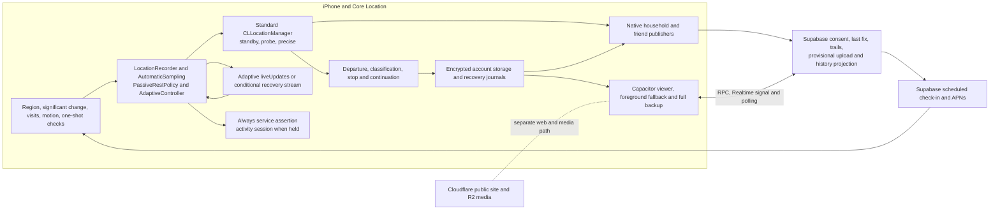

# Letm3go iOS location architecture and Life360 comparison

**23 November 2026 · Review base `9873d77` and the local stationary-location changes.** This is a source and local-test audit. Hosted Supabase migration state, APNs configuration and physical iPhone behaviour were outside the observed evidence. No production changes were made.

## Decision

**Yes, the existing iPhone, Supabase and Cloudflare architecture can support a Life360-comparable everyday family-location experience and a more detailed local travel journal.** That is a feasibility assessment. Physical parity remains unmeasured. The iPhone owns sensing, classification and durable route capture. Supabase already has the consent, latest fix, signalling, retry and history primitives. Cloudflare handles the public web surface and private media infrastructure, on a separate path from starting GPS or delivering a wake. Moving location processing there would leave the principal wake and first-fix constraints in place.

The product trade-off is between earlier fixes on short or slow departures and fewer location requests at rest. A viewer can receive an honestly aged last-known location without a new capture. A complete journal route requires actual observations. Lock, poor sky view, permission changes, limited iOS execution and user force-quit all constrain that guarantee. Prioritise preservation of any captured genuine movement, then fast visible movement when connected, and then lower stationary cost. No evidence supports adopting Life360's driving provider or adding infrastructure for this goal.

## A. What Life360 publicly documents

| Aspect | Documented Life360 functionality | Letm3go comparison and remaining unknown |
| --- | --- | --- |
| Background and stationary strategy | Life360 says it chooses when to wake and update, avoids leaving GPS on, and uses high-precision GPS in transit for drive history. Its roughly 10% shorter battery-life figure over 24 hours is a vendor estimate and varies with viewing, refresh and driving. [Battery usage](https://support.life360.com/hc/en-us/articles/23053716563223-Life360-and-Battery-Usage) | Letm3go has confirmed passive rest, reduced standby, bounded precise probes and precise journey recording. Life360's iPhone sampling cadence at rest, GPS/session ownership, iOS APIs, indicator duration and energy per mode are undisclosed. The separately documented Pet GPS power-saving cadence refers to its hardware. |
| Movement and driving | Life360 analyses location and activity. Drive Detection is powered by Arity, needs consent, background operation, strong cellular signal, battery above 10% and saver off. A drive below 15 mph may show as a Trip. [Drive Detection](https://support.life360.com/hc/en-us/articles/23053499870487-Drive-Detection-Analysis) | Letm3go classifies movement on-device and preserves a private journal even when sharing is off. Life360 publishes no equivalent guarantee of detailed standalone walks, first metres, offline route recovery, or equivalent stop/continuation rules. Compare observable routes and events, and score Letm3go journal requirements separately. |
| Viewer freshness | Life360 describes a two-second signal during supported live viewing, a five-minute viewing limit reset by refresh or reopening, and connection/permission states. [Movement accuracy](https://support.life360.com/hc/en-us/articles/23053466420887-Movement-Accuracy) · [Circle member location](https://support.life360.com/hc/en-us/articles/23053527071255-See-a-Circle-Member-s-Location) | This is a viewing claim, with feature and connectivity conditions. It gives no general capture interval or stationary freshness guarantee. Letm3go sends on eligible fixes and retrieves current authorised rows on Realtime signals or polling. Measure capture age, movement visibility and viewer delivery separately. |
| Permissions and Places | Life360 recommends Always and Precise, Wi‑Fi and applicable motion permissions, with Low Power Mode off for accuracy. Its guide recommends opening the app periodically. Places offer entry/exit alerts with documented radii of 250 feet to two miles. [Permissions](https://support.life360.com/hc/en-us/articles/23053398402839-Life360-Permission-Settings) · [Accuracy](https://support.life360.com/hc/en-us/articles/23053384044311-Improve-Location-Accuracy) · [Places](https://support.life360.com/hc/en-us/articles/35609060078743-Places-in-the-Life360-app) | Letm3go additionally distinguishes Home recognition and route arrival, and uses a wake region with its own geometry. Matching visible map radii across apps does not make their internal detector thresholds comparable. |
| History and choice | Life360 documents 2/7/30 days of history by tier, no in-app export, and per-Circle pausing. Pausing stops future updates under the ordinary sharing setting, with documented check-in and emergency exceptions. [History](https://support.life360.com/hc/en-us/articles/23053602225559-Location-Drive-History) · [Sharing](https://support.life360.com/hc/en-us/articles/23053695148823-Share-My-Location) | Letm3go's editable, durable local journal and independent sharing consent are distinct product requirements. A Life360 history screenshot is an observable display result. Raw fix timestamps and geometry are unavailable for export in the documented app. |

Apple supports minimising high-accuracy requests, using stationary or region events when appropriate, and actively requesting background updates for precise journeys. While suspended, apps may receive queued updates at their next execution opportunity. Always authorisation can support relaunch for significant change, visits and region monitoring under supported conditions. Apple documents `CLBackgroundActivitySession` as managing a visual indicator and an Always `CLServiceSession` as an authorisation assertion, including recreating it after a supported background relaunch. The location manager's prominent-indicator setting applies to Always-authorised background use, with When In Use presentation controlled by iOS. Apple also documents that Low Power Mode turns off Background App Refresh and that background pushes may be delayed, discarded or throttled. These are OS behaviours, rather than fixed wake or latency guarantees. [Efficient location](https://developer.apple.com/documentation/xcode/accessing-the-device-s-location-efficiently) · [Background lifecycle](https://developer.apple.com/documentation/corelocation/handling-location-updates-in-the-background) · [Location authorisation](https://developer.apple.com/documentation/corelocation/requesting-authorization-to-use-location-services) · [Activity session](https://developer.apple.com/documentation/corelocation/clbackgroundactivitysession-3mzv3) · [Indicator setting](https://developer.apple.com/documentation/corelocation/cllocationmanager/showsbackgroundlocationindicator) · [Low Power Mode](https://support.apple.com/en-au/101604) · [Background pushes](https://developer.apple.com/documentation/usernotifications/pushing-background-updates-to-your-app)

## B. Current architecture and lifecycle

1. **Launch and ownership.** AppDelegate starts native recovery independently of the WebView. Account opening loads protected encrypted data, settings, dwell, unfinished activities, and device sharing credentials. Foreground activation refreshes availability and recording ownership, then evaluates rest before reconciling the activity session. A persisted activity-session marker is eligible to rejoin only on a background launch in the local patch. Always service assertion has its own recovery path. Manual phone/Watch ownership suppresses competing iPhone automatic journeys as appropriate. [AppDelegate](../ios/App/App/AppDelegate.swift#L9) · [Account recovery](../ios/App/App/AccountSecurity.swift#L89) · [Activity session](../ios/App/App/LocationRecorder.swift#L638) · [Ownership](../ios/App/App/AutomaticTracking.swift#L148)
2. **Home, lock, repeated opens.** With verified place, Always and Precise access, iOS 18+ usable Always service assertion, valid exit region, significant changes and no active journey/check, passive mode stops standard updates and releases the activity session. Visits and other configured regions stay armed. Initial confirmation is six minutes at Home with corroborating Wi‑Fi, eight without, and 20 at other recognized resting places. Lock/background lifecycle observers record state; warm foreground can request one fix on the existing five-minute throttle. The local patch keeps an already earned Home rest if Wi‑Fi evidence expires before minute eight, while movement, verification and service guards still apply. Cold launch does not trust a saved dwell as fresh evidence. One accepted in-place fix can reuse its original dwell time, with standby service possible while verification is pending. [Rest computation](../ios/App/App/PassiveRest.swift#L100) · [Foreground check](../ios/App/App/PassiveRest.swift#L240) · [Background/lock observers](../ios/App/App/LocationRecorder.swift#L717)
3. **Wake, first fix, confirmation.** Exit callbacks, significant change, visit observations and useful motion/location evidence converge on a bounded probe. Motion callbacks alone do not provide a reliable wake from a suspended process. A coarse fix clearly outside the prior dwell can promote precision before strict route acceptance. The local patch captures the old dwell before place observation can clear it, so an accurate zero-speed outside fix after a passive relaunch also starts a protected probe. This is a location fix evaluated against the saved region, distinct from an actual iOS geofence callback. Both paths exist. The usual probe is two minutes, with bounded extension for observed movement, a six-minute episode budget and cooldown. Drive confirmation needs time, displacement and motion/speed evidence. A short, low-speed or slow walk inside a wake boundary can leave little or no accepted departure geometry, especially while suspended. [Probe](../ios/App/App/AutomaticTracking.swift#L238) · [Outside-fix path](../ios/App/App/AutomaticTracking.swift#L608) · [Region callback](../ios/App/App/AutomaticTracking.swift#L1557) · [Detector and budget](../ios/App/App/RecorderCore.swift#L2550)
4. **Movement and persistence.** Precise mode supplies the detector and active journal. Classification can transition between walking, cycling and driving using sustained evidence. Handoffs write durable state before replacing ownership. Backfill is an in-memory buffer of accepted fixes, up to four minutes/80 fixes, with a 30-second gap limit and up to 60 leading fixes. It recovers useful points before classification, with no geometry to recover where iOS delivered none. Late queued fixes can extend a recovered open journey when newer than its saved tail. The age filter for starting journeys is stricter. Routes preserve segment gaps after interruptions. [Backfill and delivery](../ios/App/App/RecorderCore.swift#L2513) · [Transition and save](../ios/App/App/AutomaticTracking.swift#L695)
5. **Arrival and continuation.** Automatic arrival combines movement/stillness, stop evidence and bounded motion-history waits. A published provisional stop can reopen with the same ID. Typical effective windows are 10 minutes at a saved vehicle destination, 20 at an unsaved vehicle stop and two hours on foot. A continuation can keep reduced standby or a recovery stream active even at a real destination, because open stops block passive rest. In a café use both arrival marker visibility and time to quiescent services as separate measurements. [Continuation](../ios/App/App/RecorderCore.swift#L1560) · [Stop save](../ios/App/App/AutomaticTracking.swift#L1035) · [Rest guards](../ios/App/App/QuietRestCore.swift#L120)
6. **Sharing, offline and cloud recovery.** Household and device-based friend sharing can use accepted in-place fixes to allow passive rest. Legacy friend mode, disabled automatic tracking, explicit rest opt-out, missing suitable accepted fixes, or unresolved moving status can keep standard location on. Native device payloads retain capture time. Household viewer logic has a 10-minute live classification and a two-minute moving-status window; 24-hour retention is a last-position window. Latest repository friend read keeps eligible positions up to 24 hours; the old 30-minute read remains in older schema and comments. Legacy friend publishing uses receipt time. This is a deployment/version distinction to check on physical test accounts. Sharing shutdown starts locally, then retries server revocation. The check-in migration schedules claims every 15 minutes for stale eligible positions, gated by registration/configuration. In passive mode it requests a real fix. An APNs acknowledgement does not establish delivery or a new fix. [Sharing admission](../ios/App/App/PassiveRest.swift#L158) · [Native publisher](../ios/App/App/LocationRecorder.swift#L1089) · [Viewer freshness](../src/lib/householdLocation.js#L19) · [Friend read](../supabase/migrations/20261201000000_friend_place_label.sql#L54) · [Check-in schedule](../supabase/migrations/20261130000000_location_checkins.sql)
7. **Cloud history is downstream of recording.** Local storage is atomic and encrypted per account. The native v2 path is an opportunistic finished-GPS/provisional upload on an existing sharing device credential, with a three-day age limit. The WebView performs authenticated full backup including edits and older work. The repository SQL takes privacy/membership/row locks, blocks incompatible or shorter provisional routes, protects tombstones and private references, and rolls an eligible household projection failure back with storage before returning retry. Signed-in backup remains necessary for a newer incompatible or already fully backed-up snapshot. Native failures are deferred without deleting local routes, but recovery depends on a future execution opportunity. Cloudflare is not involved in acquiring a fix, storing the encrypted journal or scheduling iOS wakes. [Local storage](../ios/App/App/RecorderCore.swift#L710) · [Native outcomes](../ios/App/App/ActivityServices.swift#L777) · [Full backup](../src/lib/cloudSync.js#L319) · [Reconciliation SQL](../supabase/migrations/20261217000000_reconcile_finished_activity_upload.sql) · [Cloudflare media boundary](../supabase/functions/journeys/index.ts)

## Audit baseline findings and what remains to measure

| Finding | Evidence and effect | Confidence |
| --- | --- | --- |
| **AC11 gap in retained movement evidence.** | Durably written low-confidence walking and short-journey evidence can be evicted by count, bytes or age. Account open calls prune with `try?` and ignores the returned evictions; normal retention logs evictions in diagnostics. A route with genuine movement can remain unconfirmed. This mechanism cannot guarantee preservation of the only durable copy, and routine open can silently remove it. Existing native quota fixtures reproduce eviction, including a 30 m sparse route fixture; the classification itself cannot determine ground truth. Confirmed published activity rows and cloud tombstones are distinct paths. [Retention](../ios/App/App/RecorderCore.swift#L776) · [Eviction](../ios/App/App/RecorderCore.swift#L846) · [Account open](../ios/App/App/AccountSecurity.swift#L117) · [Native eviction test](../tests/native/main.swift#L5956) · [Short route handling](../ios/App/App/AutomaticTracking.swift#L1518) | Confirmed policy gap. Field incidence unmeasured. |
| **Extra foreground location requests.** | The household loop falls back when native upload age exceeds ten seconds and can short-circuit in passive rest. The foreground friend loop calls `currentPosition` every 30 seconds while visible and on visibility changes, without the stationary bypass or a device-publisher check. The bridge can create a separate high-accuracy one-shot manager even during passive rest for friend sharing. The upload-age guard measures network delivery as well as sensor demand; a slow or offline RPC can leave a recent native fix eligible for redundant reacquisition. [Household fallback](../src/lib/useHouseholdPresence.js#L329) · [Friend loop](../src/lib/useFriendLocations.js#L39) · [One-shot manager](../ios/App/App/ActivityServices.swift#L425) | Confirmed overlapping request paths. Radio cost and frequency need a device trace. |
| **Recovery overlap and prolonged standby.** | Automatic mode and sharing fallbacks both reach the standard manager; a sharing change that invalidates passive rest routes through the central reconciler first. Manual ownership has a separate exclusion gate. Adaptive low-power and keep-alive streams are intentionally gated against one another. Standard route updates and a recovery `liveUpdates` stream can coexist when the foreground-held activity session cannot keep the process running. The stream's locations are unused for route geometry by design. Reduced standby, open stops and sharing-only fallbacks can keep one or more services active. Auto-pausing is deliberately disabled on standard automatic configuration. [Service policy](../ios/App/App/QuietRestCore.swift#L318) · [Sharing fallback](../ios/App/App/LocationRecorder.swift#L947) · [Keep-alive](../ios/App/App/PassiveRest.swift#L504) · [Standard configuration](../ios/App/App/AutomaticTracking.swift#L391) | Confirmed service ownership overlap. Removing it or asserting double GPS power draw would require evidence. |
| **Viewer freshness can freeze on failed reads.** | Household person and activity state are memoised from the last fetched rows, whose server clock is sampled at retrieval. The map separately ages speed. A failed poll can leave household live/at-Home or movement classification based on the previous response until a successful fetch. Friend map projection uses the running clock. [Household projection](../src/App.jsx#L347) · [Age rules](../src/lib/householdLocation.js#L26) | Confirmed clock dependency. A local fixture with a one-minute-old response still returned live, age 60 seconds and Driving at minute 11 without a read. Rendered impact varies by screen and connection. |
| **Stationary gaps are structurally possible.** | A 15-minute best-effort server schedule cannot guarantee a new capture during a 10-minute viewer live window. In the continuous-stream check-in branch the candidate flushes and can send a changed status with an actual recent timestamp, then relies on future GPS delivery. It does not guarantee a new stationary fix. Apple advises against trying more than two or three background pushes hourly; the repo's schedule can offer up to four per device if it stays eligible. [Check-in handler](../ios/App/App/PassiveRest.swift#L217) · [Schedule](../supabase/migrations/20261130000000_location_checkins.sql) · [Apple push delivery](https://developer.apple.com/documentation/usernotifications/pushing-background-updates-to-your-app) | Confirmed timing mismatch. Actual APNs delivery and battery impact require measurement. |
| **Late journey starts and delayed finished history.** | Passive detection depends on wake conditions and valid fixes. Poor GPS, a very short or slow departure, sparse delivery and qualification delays can reduce capture. Duplicate uploads are guarded locally and by the current SQL; a quiet or newly offline phone can receive no execution in which to retry. A fully backed-up or divergent private route requires the authenticated path, and device import/older entries can wait for it. [Backfill](../ios/App/App/RecorderCore.swift#L2513) · [Native retry](../ios/App/App/ActivityServices.swift#L777) | Confirmed bounds and dependencies. Miss/split rates and cloud convergence latency are unmeasured. |

## Release blocker implementation

- **Evidence retention.** Credible displacement and uncertain observations are kept in the encrypted account store. Only an aged, decoded record with no samples or repeated identical accurate zero-speed samples can expire automatically. No count-based eviction remains. New evidence has a 48 MiB admission cap; existing over-cap or unreadable files are kept. A refused transition leaves its source draft or replay journal intact, and startup records completed cleanup and deferrals after opening the diagnostic journal. If a journal cannot be replayed, automatic recording waits for recovery. Confirmed activities use their existing independent storage. See [recovery and storage pressure](stationary-indicator-acceptance.md#private-evidence-and-storage-pressure).
- **Viewer age.** The original position timestamp anchors location and movement. A successful household read supplies server time and a local monotonic receipt anchor. Elapsed time advances during failed reads, with foreground reconciliation after suspension. Moving labels expire after 120 seconds, current place after 10 minutes, and last-known coordinates after 24 hours. An old movement label, when shown, is explicitly last-known. Older RPCs without server time anchor to the viewer's wall time at receipt. Their initial age carries that clock uncertainty; where a legacy publisher supplies receipt time only there is no original capture value to recover.
- **Publisher requests.** Household, friend and presence can consume accepted recorder observations within their requested age and accuracy limits. Pending native one-shots can serve multiple eligible callers. A stationary answer requests no fix; an ineligible or stale observation still allows a fresh request. A device friend publisher uses its timestamped native path; the legacy friend fallback remains available when device publishing is unavailable. Sampling diagnostics distinguish reused and new fixes, requester, capture time, age and accuracy.

These changes address the code causes documented in the findings table. They do not establish field parity or recover evidence that an older build already evicted.

## C. Architecture decision and prioritised plan

Keep one recorder as the authority for sensor mode. Treat monitoring, precise recording, sharing, and persistence as distinct responsibilities within the current system. Monitoring should vend qualified observations and wake evidence. The journey engine should own precision escalation and recorded geometry. Publishers should consume actual captured observations and manage consent, cadence, reconnection and viewer age. Persistence should independently preserve evidence and track local save, provisional storage, projection and full backup outcomes. This can be advanced incrementally with the existing recorder, outboxes and RPCs.

| Order | Change and evidence gate | Benefit | Reliability impact | Implementation risk |
| --- | --- | --- | --- | --- |
| P0 | Protect the only durable copy of genuine or unresolved movement from silent expiry. Keep low-confidence routes private and recoverable under their stable IDs. Test old files, capacity handling, crash/restart, local deletion intent and offline retry. | High | Prevents irreversible AC11 loss | Medium |
| P0 | Run the paired benchmark and require AC11 tests plus supported-condition physical runs before release. Gate changes to wake/continuation on observed failure categories. | High | Makes missed routes and regressions attributable | Low |
| P1 | Age viewer state from the server-clock sample plus elapsed time and invalidate motion/live badges even when retrieval fails. Show last confirmed place with honest age. Distinguish viewer refresh, phone capture and projection acknowledgement in diagnostics. | High | Improves trust under poor connectivity | Low |
| P1 | Share recent accepted native fix with both foreground publishers and coalesce explicit one-shot requests. Separate sensor freshness from the time of last successful RPC. Keep an intentional fresh-fix path for consent, place editing and controlled verification. Measure one-shot reduction and verify no moving freshness regression. | High | Reduces unnecessary sensing without losing source observations | Medium |
| P1 | Measure release-to-wake and wake-to-first-fix independently. Target only observed weak cases, such as a small walking departure after passive rest or an unnecessary long standby during continuation. Compare baseline/candidate gaps and splits together. | High | Can improve early routes while preserving quiet rest | Medium–high |
| P2 | Instrument or reuse counters to distinguish native upload pending, publication, and full backup. Make reconnect and refreshed credentials explicit retry opportunities while the process runs. Consider a measured way to finalize stable stopped routes earlier without changing IDs or duplicating history. | Medium–high | Improves eventual sharing and backup | Medium |
| P2 | If matched-day traces show a stationary cost, test one variable at a time: scheduled check-in duty cycle, late continuation standby, recovery-stream duration or adaptive opt-in. Retain a rollback control and test device/legacy sharing separately. | Conditional | Could save power; removes coverage if chosen poorly | Medium–high |

Keep the supported geofence/significant-change/visit recovery paths and the precise engine for confirmed movement. Avoid shortening or widening Home thresholds from this source audit, removing the recovery stream without a matched locked-screen test, forcing a new fix on every viewer refresh, relying on silent pushes or Core Motion as the sole wake, and turning on automatic pauses globally. Keep genuine route points and stable IDs through classify/stop/retry. Avoid fabricated backfill, deletion based on classification or upload failure, stale timestamp renewal, privacy bypass, and replacing a newer route or user edit. Use existing infrastructure until a measured bottleneck demonstrates a specific shortfall.

## D. Physical benchmark and diagnostic collection

**Measured physical results are pending for both apps.** The candidate has automated coverage only. Life360's battery statement and feature guidance are documentary context. The gates below are proposed acceptance targets, to be agreed before data collection.

### Matched setup

- Use the same test iPhone sequentially for Letm3go baseline, the local candidate and Life360, with other tracker services off for each battery run. Randomise order across matched daily runs. A second matched phone may run side-by-side for route conditions if you swap app/device the next run; keep sequential runs for battery and indicator attribution. Record iPhone model, iOS, build hashes/versions, battery health, starting charge, thermal/environment conditions, screen use, permissions, service readiness and connectivity. Include a same-phone tracker-off control day.
- Use a second device as a household/Circle viewer and an independent externally powered GNSS logger or surveyed route and synchronised external video for ground truth. Disable unrelated location apps on the test phone. Record expected local/UTC time and clock offsets before and after. Viewer sessions use the same monitoring pattern and frequency; run separate unopened-viewer and active-viewer trials. Record Life360 tier, country, Drive Detection/Arity consent and viewing mode. Use consenting test accounts and synthetic labels.
- Run at least three paired exploratory repeats per scenario and device, then at least ten supported driving and ten walking departures per build for release screening across two iPhones if available. Report each run, median, worst and sample size. Use p90/p95 only where sample size supports interpretation. Missing or interrupted observations count separately in the denominators. Repeat a 24-hour matched schedule at least three times for battery. Start unplugged at the same charge and compare percentage-point drain against control, screen/background activity and iOS Battery per-app usage. Never convert vendor relative battery-life estimates into percentage-point measurements.
- Keep supported defaults (Always, Precise, Motion, Background App Refresh, good battery/connectivity), then vary one of Low Power Mode, screen lock, reduced accuracy, no Wi‑Fi, poor GPS or offline networking. Log Low Power Mode transitions and Background App Refresh status. Keep verified OS termination distinct from user force-quit, and tag unknown process interruption separately. Disconnect data without disabling location for the offline route test; use a separate Airplane Mode trial if needed.

### Scenarios

| Scenario | Run design and ground truth |
| --- | --- |
| Home rest and warm opens | Observe 10 minutes and an overnight quiet interval. Include Wi‑Fi corroboration loss between minutes six and eight, Wi‑Fi off, repeated 10–30 s opens, normal lock, and reopening a still-running process versus a fresh process. Compare sharing off, household, device friend, both, and legacy or sharing-only fallback in Letm3go. |
| Drive and walk from Home, locked | Begin outside the app. Record doorway/vehicle motion onset, boundary-crossing time and independent GNSS. Include a short walk entirely inside Home, short loops, a slow car departure below the Life360 Drive threshold and a normal drive. Score Life360 Trip and Drive observables separately. |
| Poor GPS and dense streets | Repeat from a garage, between tall buildings and near a parallel road. Note reference accuracy, first valid outdoor point, reacquisition and false route jumps. Include transitions drive → walk → drive, traffic queue, stop/start congestion. |
| Other places and arrival | Test saved place, a new/unsaved place, two nearby places, a café stop of 90 minutes and return Home. Record physical stop, viewer arrival/place update, provisional publication, continuation ID, final stop classification and release of services. |
| Connectivity and process recovery | Lock while driving/walking, remove data, continue and stop, reconnect while still locked, then foreground. Repeat with observed OS termination/relaunch and separate swipe-away. Check stored route, segments, backup receipt, household projection and local privacy/revoke state. Exercise a temporary credential/server failure in an isolated environment. |

### Measurements and collection rules

| Metric | Definition and evidence source |
| --- | --- |
| Blue indicator % and duration | External camera on the iPhone screen. Divide blue indicator seconds by observable stationary screen-state seconds; report visible foreground, wake/unlock and unobservable screen-off time separately. Track longest uninterrupted interval and suspected app attribution. Use diagnostics as an explanation, with video as the observation. |
| Continuous location and session duration | Integrate Letm3go `standardLocationUpdatesActive`, activity/service-session held states, and keep-alive intervals across lifecycle events. Report requested standard location time per day, precise subset, overlap, and unknown spans where logs cannot establish state. This is a proxy for GPS demand. Life360's actual standard request time, private session durations and GPS hardware uptime are unavailable; use matching observable indicators and Battery data. MetricKit/Instruments can supplement a development build if current logs cannot attribute energy. [Apple battery analysis](https://developer.apple.com/documentation/xcode/analyzing-your-app-s-battery-use) |
| Wake, first fix and missing route | Measure reference motion onset → first logged wake, wake → first accepted route-quality fix, and onset → first saved point. Also capture accuracy and delivery lag (callback time minus capture time), and time to journey confirmation. Find the first saved point on the reference track by time and geometry; calculate reference distance from onset to that point. Keep raw sensor acceptance, route backfill and displayed start separate. For Life360 report first visibly updated movement/route and displayed missing distance only, with screenshot resolution and unknown internals noted. |
| Geometry, splits, misses, arrival | Compare matched reference distance and segment-by-segment deviation, median and worst. Use screenshots only for Life360 where raw export is unavailable. A missed journey has no saved/displayed equivalent by the declared cutoff, excluding journeys outside the product's documented scope in a separate row. Classify unwanted splits and unwanted merges by a scenario-specific reference itinerary, and calculate physical stop → viewer arrival, stop → provisional journal, and stop → final journal separately. |
| Freshness and recovery | At fixed viewer timestamps record displayed age, movement status, known capture/receipt timestamps, missing/offline status and first visible motion. For Letm3go split capture → server ack → viewer presentation and verify age advances when reads fail. Score reconnect/relaunch → local route recovered, → native projection if eligible, → authenticated full backup; compare stable ID, point counts/tail, user edits, privacy and tombstone outcomes. For Life360 record observable display/recovery only. |

Export Tracking & Permissions diagnostics immediately after each run. Keep route/reference data separately on the device or in an approved private location. Use run IDs to align timestamped observer notes, viewer screenshots and anonymised recorder diagnostics. Existing export contains session state, mode durations, first-fix/departure evidence, sharing counters, viewer latency, recovery and battery availability; bounded retention, missing intervals and lack of coordinates are explicit. Store a workbook row per trial with variant, scenario, settings, timestamps, outcome, geometry error, battery readings and missing-data reasons. Record unobservable values as unavailable. Add diagnostics only if the first trials show a specific missing transition or capture→viewer correlation. [Diagnostics contract](../ios/App/App/RecorderCore.swift#L3328) · [Earlier indicator protocol](stationary-indicator-acceptance.md#paired-physical-iphone-protocol)

## E. Proposed experience acceptance

- **AC11 is a release gate.** Zero silent loss of durably recorded genuine movement across classification, closure, retry, offline recovery or storage pressure. Preserve stable IDs and captured points, and protect newer edits and explicit privacy/deletion. Unresolved genuine movement stays private and recoverable. The new policy protects saved routes through pressure. A full store can still defer recording or recovery, and AC11 cannot guarantee capture of new movement when storage is unavailable.
- **Quiet rest.** Across verified Home warm opens and relocks, zero new continuous requests or activity sessions attributable solely to reopening, and zero confirmation-clock resets when evidence remains valid. Proposed physical target is at most 5% blue-visible time during observable, settled stationary intervals, excluding separately reported deliberate verification and manual recording.
- **Reliable departure.** In the supported ten-drive and ten-walk screening matrix, zero missed ordinary departures, with short/edge cases reported separately. As initial review thresholds, aim for median onset-to-first accepted fix within 15 seconds driving and 30 seconds walking, and no degradation against baseline in worst missing metres, total distance error or undesired splits on matched routes. Report misses even when they prevent latency measurement. Retain early geometry when obtained, and flag gaps when it was unavailable.
- **Useful sharing.** On online moving trials, aim for a viewer update within 15 seconds of the first accepted shareable fix in at least nine of ten trials. Age advances without a new capture on connected and disconnected viewers; a place can remain visible as last known. After a new genuine fix, clear stale state on the next successful viewer update. Never pass by refreshing capture timestamps artificially. Track arrival-alert latency separately from final journal completion. For the normal connected saved-place arrival use a provisional 90-second viewer target and require no false arrivals in the traffic fixture. For open-sky routes above 1 km driving and 400 m walking use initial absolute distance-error targets of 5% and 10%, respectively, and review geometry and missing start distance separately. These values are targets for the benchmark, with no field calibration claimed.
- **Battery and recovery.** On matched days, target no increase in median background battery drain versus baseline and use Life360/control figures to quantify the margin. All offline test fixtures retain local routes across relaunch, and eligible uploads and projections converge after connectivity and a supported execution opportunity or authenticated foreground sync. Record actual elapsed time, a proposed two-minute connected foreground catch-up gate for the small test backlog, and clearly distinct results for user force-quit and Low Power Mode.

## Local verification

`npm run test:native` passed 2,656 assertions. `npm run test:recorder:sim` built the iOS simulator app and passed 171 assertions. `npm run test:postgres` passed 24 tests in the local PostgreSQL harness. Five targeted viewer, permission and sync files passed 100 tests. The local lifecycle regression exercises expired Wi‑Fi on repeated opens, continued wake registrations, stale verification, restored dwell, and a first accurate zero-speed fix after a fresh recorder instance restores state. Simulator assertions establish app decisions. Visible system indicators, physical journey latency and comparative battery usage remain device measurements.
