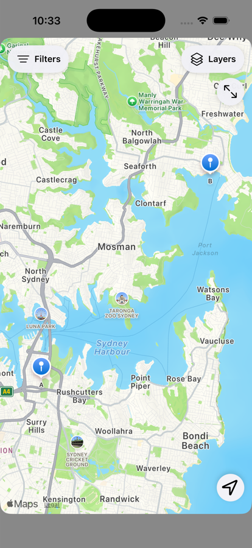
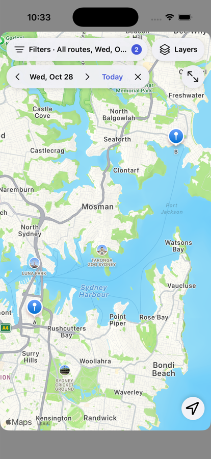
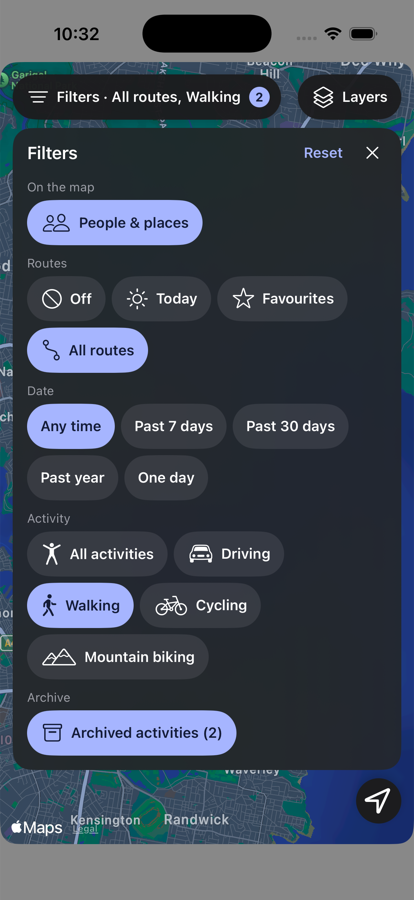
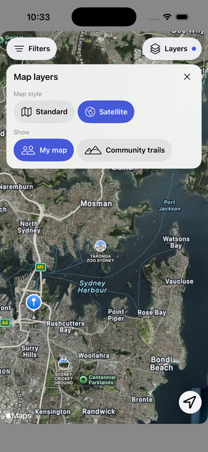

# Map page controls: audit and redesign

The controls are one serializable
model (`mapControls` in `src/lib/mapToolbar.js`), drawn by UIKit in
`ios/App/App/AppleMaps.swift` and by React in `src/components/MapLayers.jsx`. Neither
renderer holds filter state. Actions return to React through `layersTapped`.

## Original controls

"Web" means the fallback shown when no native map is embedded. Maps themselves are
iPhone-only. All saved state is `letm3go:map-view:<user>` in localStorage (per account,
per device).

| Control | What it did | State | Type | Saved | Problem | Now |
|---|---|---|---|---|---|---|
| Sliders, top left (both) | Opened the icon column. Labelled "Map layers" though it held filters | `layersOpen` | Panel | No | Wrong name; only a dot when active | **Filters** pill with count and summary |
| Map icon | My routes / Community trails | `content` | Strip | Yes | Looked like map style, was not | Layers › Show |
| People icon | People & places on/off | `people` | Toggle | Yes | Blue by default, so blue did not mean "filtered" | Filters › On the map |
| Route icon | Opened route choices | category only | Strip | No | Same glyph as the "All routes" option inside it | Filters › Routes (category removed) |
| Sun | Today layer: rolls over at midnight | `routes` | Option | Yes | Next to a second Today in Calendar | Filters › Routes › Today |
| Star | Favourites layer | `routes` | Option | Yes | Icon only | Filters › Routes › Favourites |
| Route (option) | All routes | `routes` | Option | Yes | Duplicate glyph, see above | Filters › Routes › All routes |
| Prohibition | Routes off | `routes` | Option | Yes | Meaning unclear; web drew an X, iOS a prohibition sign | Filters › Routes › Off |
| Calendar | Opened date options | category only | Strip | No | Blue while ignored (routes off) | Filters › Date, and the date bar |
| Chevrons, date | Previous/next/return to Today | `day` | Action | Yes | Needed two taps to reach, every time | Date bar on the map |
| Clock options | Any time, 7d, 30d, year | `range` | Option | Yes | Text only because they had no distinct icon | Filters › Date |
| Walking person | Opened activity choices | category only | Strip | No | Looked like a walking filter; actually every activity | Filters › Activity |
| Expand (iOS) | Full-screen map | none | Navigates | No | 36 pt target | Same action, 44 pt, under Layers |
| Compass (iOS) | Adaptive, only when rotated | none | Action | No | Already contextual; system compass on Trails could sit under controls | Same, placed below Full screen on both maps |
| Location (both) | Follow me | `camera` | Action | No | Blue when idle and when following | Neutral when idle, accent only when following |
| Following chip (iOS) | Show everyone | `camera` | Action | No | Next to the sliders button | Same, below the left column |
| Satellite switch (full screen only) | Map/Satellite | none | Action | **No** | Lost on close; absent on the embedded map | Layers › Map style, saved, and in step with the full-screen switch |
| Bottom navigation | App pages | `tab` | Navigates | No | None; not related to map filters | Unchanged |

Other findings:

- Several icons were blue at once because selected, default-on, and ignored states all
  used the same fill. People was blue on a fresh install.
- Route and calendar category icons repeated their own options.
- **Archived activities were always drawn on the Map** and there was no Map filter for
  them, unlike Activities. The new filter defaults to on, so nothing changes unless used.
- `mapToolbar` computed its own `today` rather than taking the App's.

## Final design

Always on the map: **Filters** and **Layers** (both labelled), Full screen, location.
Appearing when relevant: date bar, Following chip, compass.

- **Filters** changes what is shown. With filters on it reads
  `Filters · All routes, Walking` with a count, so they stay visible while closed.
- **Layers** changes how the map is drawn. A dot marks a non-default choice. Community
  trails is a different map with nothing to filter, so Filters is hidden there.
- **Date bar** appears only while routes are limited to one day: previous, date, next,
  Today (when in the past), and clear. Stepping needs no panel. From the Today layer,
  stepping back moves to All routes; Favourites stays Favourites. This is the existing
  `chooseMapDay` logic, including segment-by-segment day matching and local-day handling.

The two "Today" choices stay different: Routes › Today rolls over at midnight, while a
selected day is fixed and can be combined with Favourites. Date offers "One day", so the
panel has only one Today.

### What colour means

| Appearance | Meaning |
|---|---|
| Accent chip, in a panel | Applied now |
| Neutral chip, in a panel | Available |
| Accent badge or dot, on the map | Something non-default is applied |
| Accent location button | Following you |
| Accent text | An action: Reset, Today |
| Dimmed | Unavailable |
| Accent tab | Current page (unchanged) |

A saved range is not shown as applied while routes are off, because it is not applied,
and it is not counted either.

## Before and after

| Before | Now |
|---|---|
| Sliders → icon column → category → option | Filters → labelled choice |
| Calendar → chevron, repeatedly | Date bar → chevron |
| Map icon → Community trails | Layers → Community trails |
| Full screen → Satellite (forgotten) | Layers → Satellite (saved) |
| Sun / Star / Prohibition | Today / Favourites / Off |
| No Map archive filter | Filters → Archived activities (only if any exist) |

The captures are real UIKit controls on MapKit in the iOS 26.5 simulator, driven by a
temporary page calling the `AppleMaps` plugin, so the markers and the pill text in them
are test data rather than a signed-in account.

## Safe by construction

- Filter and panel changes reuse the same `MKMapView`. The camera padding is fixed, so
  a date bar appearing cannot move the camera.
- Touches on controls are excluded from the map's gesture recognisers, so scrolling a
  panel cannot count as exploring and end Follow mode.
- A tap on the bare map closes a panel without cancelling the tap, so MapKit still
  receives it.
- Saved views load unchanged: `style` and `archived` default to today's behaviour.
- No migrations, and no tracking, publishing or backend changes.

## Check on a physical iPhone

1. Pan, pinch and rotate with a panel open; the map stays smooth.
2. Follow a household member, change filters: Follow stays on and the camera holds.
3. Tap a person's marker with a panel open: the panel closes and the marker selects.
4. Scroll a tall panel at large Dynamic Type; every chip reaches the screen.
5. Live household updates arriving while Filters is open do not reset its scroll.
6. Change style in full screen, close: the embedded map and Layers match.
7. Satellite: pills and date bar stay readable over imagery.
8. VoiceOver through Filters, the date bar and a panel.
9. Smallest supported iPhone: Filters summary truncates and Layers stays whole.
10. Community trails: controls clear the Trails/Segments row above the map.
