# Tesla automatic recording — implementation and deployment review

Prepared 25 October 2026, build 42. **Not deployed or enabled on a real vehicle.** The primary success criterion (real telemetry received and converted into a stored journey) has NOT been verified. This package is ready for local review and a controlled pilot deployment after approval, not an assertion of production readiness.

## Existing setup and what was actually verified

The user reports Tesla application/registration/billing, OAuth and the existing `tesla` Edge Function are working. These were preserved, not re-registered or reconfigured. No billable Fleet request, real vehicle discovery/configuration, wake, secret rotation, DNS change or paid deployment was performed by the agent.

Public checks: `https://letm3go.au/` and its Tesla public-key URL returned HTTPS 200 with certificate verification enabled. The hosted public key matches `~/.tesla/letm3go/public-key.pem`. The existing private key is a regular 0600 file; the public file is 0644. Private material was not printed, uploaded, regenerated or put into the app. A preliminary generic HTTP-client request was rejected; browser-user-agent requests succeeded. Before production, verify the endpoint is challenge-free with Tesla's tooling and review any Cloudflare bot rule that treats non-browser clients differently.

## Architecture

```mermaid
flowchart LR
  V[Tesla vehicle] -->|mTLS / WebSocket| R[Official Fleet Telemetry receiver]
  R -->|durable ACK| K[Private Kafka log]
  K --> C[Trusted Node consumer]
  C -->|HTTPS + timestamped HMAC| I[telemetry-ingest Edge Function]
  I --> DB[Existing Supabase activities + source evidence]
  A[Letm3go iPhone] -->|Supabase authenticated request| T[tesla-recording control/feed API]
  T -->|restricted HTTPS + HMAC| G[Configuration gateway]
  G --> P[Official Tesla vehicle-command proxy]
  P -->|signed configuration| F[Tesla Fleet API]
  DB --> T
```



A standard Worker/Edge Function is NOT the vehicle receiver. Vehicles terminate mTLS at Tesla's official Go receiver. Its pinned source embeds Tesla production client certificate roots and binds records to the authenticated vehicle VIN; no test CA or anonymous vehicle ingress was added. Cloudflare remains the public website/DNS provider, not a TLS-terminating reverse proxy for the receiver.

Source revisions inspected and pinned:
- Fleet Telemetry `bd076fe1494841707528449560c4a19d0d426da4`.
- Vehicle Command proxy `fc5a1910ad45c42921d541089e3e366d0b897f52`.

`services/fleet-telemetry/compose.yaml` is an isolated **single-host pilot**, not a high-availability architecture. Production expansion requires replicated Kafka/durable storage, tested backup/restore, TLS renewal, monitoring and load tests. The receiver's status endpoint is a liveness signal, not proof that vehicle mTLS has worked; readiness also requires synced configuration and actual accepted telemetry. No Docker executable was available here, so images were not built and the container topology was not exercised.

## Application/database integration

Existing `activities` are still the original driving segments. Tesla processing creates `recording_mode='tesla'` source activities; native GPS sources are never overwritten. Logical parent journeys remain the existing grouping projection, referencing originals. No second independent Tesla travel journal was created.

Pending migration: `supabase/migrations/20261026000000_fleet_telemetry.sql`.

It adds nullable activity vehicle identity, ownership constraints, and:
- `fleet_bindings`: one canonical recording owner per VIN, selected vehicle, opt-in activation time, pairing/configuration/connection state and separate future household-sharing consent.
- `fleet_receiver_health`: private trusted consumer heartbeat.
- `fleet_events`: immutable, normalised, minimum required event fields with fingerprints and event/receive timestamps.
- `fleet_segments`: linkage to existing source activities, replay identity, incomplete status and explicit household audience.
- `fleet_charging_stops`: measured charging-session evidence, not another journey system.

Only the service role can ingest/manage these records. A normal client cannot fabricate a telemetry activity or overwrite source route/time/vehicle data. Owners may edit their activity metadata or explicitly delete an activity; its source registry/tombstone prevents replay resurrection. Service-only RPCs lock per VIN, deduplicate fingerprints, check revision before atomically committing a reconstruction, enforce activation boundaries, reject deleted/frozen/disconnected owners and preserve existing user titles/notes/tags/corrections. A retention-window replay cannot replace a complete source with its truncated tail.

RLS exposes source activities only to their owner, or current members of an explicitly selected household for journeys starting after the sharing opt-in. The publisher must also remain a member. Sharing disable/household removal stops that access. Household membership alone never grants management of someone else's Tesla account, raw telemetry or private iPhone history. A second account cannot claim an already-bound VIN and create another canonical household stream. This first release requires an explicit operator transfer for a change of recording owner.

No old rows are deleted by the migration. It adds constraints/policies/triggers and changes future handling of Tesla-source activity writes. Review it before deployment; do not replay the six already-applied migrations or use an unrestricted `db push`.

## Ingestion, ordering and reliability

The official receiver dispatches decoded protobuf JSON with authenticated VIN Kafka keys. `consumer.mjs` checks VIN/payload agreement and normalises only the selected signals. It sends a 60-second-window HMAC over the exact body; Supabase verifies it before accessing its service role. Neither mobile clients nor the public OAuth callback can ingest telemetry. The consumer has no Supabase service-role key and no Tesla OAuth/signing key.

Kafka offsets commit only after database projection success, or after an invalid frame is written durably to the private rejection topic. Retries use bounded exponential backoff; consumer crashes retain offsets and the container restarts. Reconnects, duplicates and out-of-order frames are replayed by event time. Only measured coordinates are retained; long gaps and implausible jumps break route polylines. A missing Park event leaves an honestly incomplete source, not an invented endpoint. Connectivity messages update connection state but cannot start a drive or stand in for actual journey telemetry.

Replay is bounded to seven days and 50,000 retained events per VIN. Raw Kafka and normalised event retention is proposed as seven days; completed source activities and measured charging sessions survive raw retention. `purge_processed_fleet_events()` removes only expired events with a fully committed projection; schedule it as described below. No retention job has run. Kafka's retained raw data does not disappear instantly on account deletion; queued events become unassociated/ignored after binding removal and expire on retention. This retention/deletion policy needs operator/privacy review before deployment.

**Scaling limit:** the current processor replays a bounded VIN window per accepted frame. The kernel processed 10,000 synthetic events in about 12 ms on this Mac, but database payload transfer, write amplification, multiple concurrent VINs and broker lag have not been benchmarked. Add batching/incremental checkpoints before a broad rollout; do not infer production capacity from the pure-function timing. At the hard event budget, ingestion fails closed and reports a processing problem rather than dropping data silently. That cap is not a Tesla billing cap.

## Minimal signal plan

| Signal | Minimum interval | Minimum delta | Use |
| --- | ---: | ---: | --- |
| Location | 10 s | 25 metres | Route and stop coordinates |
| Gear | 1 s | On change | Drive/Park boundaries |
| VehicleSpeed | 30 s | 5 mph | Movement corroboration |
| Odometer | 60 s | 0.1 mile | Measured driving distance |
| DetailedChargeState | 10 s | On change | Confirm actual charging |
| BatteryLevel | 300 s | 1 percentage point | Charging before/after |
| DCChargingEnergyIn | 300 s | 0.5 kWh | Reliable observed energy delta |

Tesla reports speed in mph and odometer in miles; the normaliser converts to m/s and metres. Detailed charging state is typed, not inferred from nearby charging POIs. Odometer deltas are accepted only if plausible for the observed duration. The DCChargingEnergyIn field is documented as usable during AC and DC charging. Energy is omitted when the start/end counter is not trustworthy or resets; no facility or charging category is guessed. Battery/time observations are retained when available. Tesla Location does not supply a GPS accuracy measurement: route points use a conservative compatibility value (65 m), explicitly marked `accuracySource='unreported'`, and the UI states accuracy was not supplied. It is not presented as measured precision.

Minimum-delta support depends on firmware/client version; inspect the real response before enabling. Current configuration uses modern client features. Do not assume the minimum Fleet-compatible firmware supports every selected field; rejected configurations remain setup errors, never active recording. No climate, seat, cabin, destination-name or unrelated personal signals are requested. No `vehicle_data` polling or `wake_up` route exists in this implementation.

## Driving, charging and logical journeys

Gear/movement evidence opens a source drive; Park closes it. Significant missing intervals split geometry and can split incomplete drives. Delayed events reprocess deterministically with overlapping existing source IDs retained. Source deletion stays deleted. Driving by another authorised person is a **vehicle journey**, not a claim about driver identity, and needs no iPhone in the car.

A DetailedChargeState charging transition opens a measured charging session; complete/stopped/disconnected/no-power closes it. Nearby infrastructure alone remains “Possible charging.” A Drive shift closes an unclosed charge incompletely if a stop signal was lost. Timestamped source events remain separate from grouping choices.

Raw driving and charging records are stored on the server while the phone is closed. Place recognition, tags and logical parent grouping currently run when the app next opens/refreshes, reusing the existing native geocoder and journal projection; a separate server-side geocoding/group-metadata sync service has not been implemented.

The existing grouping rules handle 35-minute Kew charging stops, other continuous road-trip breaks and overnight suggestions. Actual verified charging events feed that same engine. Stops retain locality (e.g. Kew), state/region (e.g. NSW) and conservatively recognised category tags. Nearby POIs must be clearly closest to be named; ambiguous businesses are not assigned. Users can edit stop names/tags and parent names, merge/split and undo through the existing UI. Automatic inference does not erase originals or manual choices. Saved Home/Work locations are private and are not disclosed to household members for grouping.

## iPhone/Tesla reconciliation

`fleetJourneys.js` links sources only when known vehicle identity, substantial time overlap, endpoints and route samples corroborate a single physical drive. The most complete observed route is preferred, while originals, iPhone photos/notes/tags and user titles are retained as source references. Linked originals remain individually accessible. It never sums the same drive's two distances.

Unknown vehicle identity or differing route coverage gives a suggestion, not a silent merge. A user can assign the original iPhone activity to its Garage vehicle or explicitly link matching known-vehicle sources. Native manual/corrected activities now persist stable vehicle UUIDs so renaming a vehicle does not break future associations. A household-shared canonical Tesla source can reconcile with a member's own iPhone recording only when known identity and route evidence match; unrelated people/vehicles are not combined. No private phone photos or notes are uploaded by reconciliation.

The authenticated cloud feed reads the existing activities through RLS, ten records per page with older-page loading. It is not a historical Tesla API importer. Reopening/focusing refreshes access; downloaded cloud records are held in the signed-in UI memory, not a new shared localStorage cache. Native recordings remain available offline. Cloud journeys need connectivity after an app restart; an encrypted native offline cloud cache is a remaining improvement.

Manual grouping/stop overrides are still encrypted device-local preferences, as in build 40. They are **not yet synchronised between household phones**. Shared automatic groups can be derived for each authorised viewer; household viewers cannot edit the recording owner's group. A production household-wide override-sync design remains to be reviewed using the existing model, not falsely claimed complete here.

## Pairing and per-vehicle setup

`tesla-recording` is a separate authenticated control/feed API; it reuses the existing encrypted OAuth credentials and lease/refresh code. The working OAuth callback is preserved. Vehicle identity comes from that owner's actual Fleet discovery cache, never a client-provided VIN/owner/household. Older caches need one explicit vehicle-discovery refresh to obtain VINs; this does not require reconnecting OAuth.

1. Connect Tesla (already working), optionally update the location grant if it was declined.
2. Choose/import one or more vehicles (existing multi-vehicle flow).
3. Open a Tesla vehicle's details and check setup. Pair with `https://tesla.com/_ak/letm3go.au?vin=...` where required.
4. Explicitly consent to future vehicle journey/location recording.
5. Configure through the restricted gateway and official signer; verify Tesla reports the intended host/config synced.
6. Only actual telemetry received after the current activation epoch, plus healthy receiver/configuration, permits recording-readiness status.

Compatibility is read from Tesla, not guessed from the VIN/model name. Normal signed telemetry requires firmware 2024.26+, with selected field/client features potentially requiring newer firmware. Intel Atom S/X need firmware 2025.20+ and the in-car **Allow Third-Party App Data Streaming** toggle; they can be supported without a virtual key. Pre-2018 S/X without the relevant upgrade are unsupported. Key capacity, unsupported firmware/hardware, config limits, granular hidden location, revoked scopes, rate/billing limits and asleep vehicles remain actionable setup failures. No wake command is issued to repair them. The installed vehicle/config response is authoritative; Tesla's documentation differs across endpoint variants on older hardware.

Garage list rows show compact recording status. Details show key/toggle status, config sync, stream connectivity, activation time, last telemetry, errors, enable/disable and separate future-household-sharing consent. “Tesla connected” is never equivalent to automatic recording. Disable immediately stops accepted ingestion; remote removal must also succeed to stop vehicle streaming/billing. If removal is pending, the UI says so. Sign-out preserves Tesla authorisation; account deletion still requires Tesla consent revocation/disconnection before deletion, and database telemetry then cascades with the account.

## Costs and limits — USD engineering estimate, not a quote

Official public rates checked 25 October 2026: 150,000 streaming signals/$1; 500 device-data requests/$1; 1,000 commands/$1; 50 wakes/$1. Tesla documents a $10 monthly application/account discount and optional billing cap with alerts at 80% and 100%. Do not apply that credit separately to every vehicle. Actual AU invoice currency/taxes/exchange rates and current portal pricing must be checked by the operator.

Illustration: 60 driving hours/month, 30 charging hours, 90 awake hours, 60 drives; location at 10 s, speed 30 s and odometer 60 s while changing; battery/energy and six gear/charge transitions per drive. About **34,200 signals ≈ $0.228**, plus four setup data requests ($0.008) and two configuration commands ($0.002): **about $0.24/vehicle/month before credit**, zero wakes. This is a model, not observed usage; location jitter, retransmissions, awake time and signal behaviour can increase it. `services/fleet-telemetry/costs.mjs` exposes the assumptions. Even failed requests below HTTP 500 may be billed.

For hosting context, AWS publishes 4 GB Linux/2 vCPU at $24/month and 8 GB at $44/month; these are comparison prices, not a provisioned recommendation or confirmed Sydney quote. A dedicated small pilot host is an **approximately $24–44/month shared infrastructure allowance**, plus backup/storage/egress, Supabase usage and tax. Kafka replication/HA costs more. No plan was upgraded or instance created.

App controls: explicit operator `FLEET_VEHICLE_SETUP_APPROVED=true`, five setup operations per vehicle/owner per operation-budget window, fixed minimal config, no repeated Fleet polling, no wake endpoint, bounded consumer retries, 50k event replay cap, private receiver Prometheus metrics, Kafka lag/retention and fail-closed stale-heartbeat status. Configure the authoritative **Tesla Developer Portal billing limit** manually before approval; a local signal counter is not a reliable invoice or a replacement for that cap. Review counters/usage weekly for the pilot. Alerts on stale receiver heartbeat (>2 minutes), queue lag, ingestion 401/503, disk/retention pressure and certificate expiry are required operational setup; no notification channel was silently configured.

## Exact proposed deployment steps — approval required

### A. Approve a concrete pilot scope

Review the migration, both new Edge Functions, the compatible `tesla` response/cache extensions, receiver/consumer/control package, paid host allowance, new DNS-only `fleet.letm3go.au` record, logging/retention policy and Tesla billing cap. No blanket migration replay, paid plan change, telemetry enablement or TestFlight upload is authorised by this document.

### B. Database and application backend

1. Validate the migration against a staging/local clone, including existing rows and RLS. Apply **only** `20261026000000_fleet_telemetry.sql` after approval. Existing six migrations must not be replayed.
2. Configure separate random 32-byte-or-greater `FLEET_INGEST_SECRET` and `FLEET_CONTROL_SECRET` through secure server secret entry (not chat/Vite/app).
3. Configure `FLEET_RECEIVER_HOST=fleet.letm3go.au`, `FLEET_RECEIVER_CA` (the **server certificate's trust-anchor chain**, not Tesla client/test CA), `FLEET_CONTROL_URL=https://fleet.letm3go.au:8443/configure`.
4. Keep `FLEET_VEHICLE_SETUP_APPROVED=false` until infrastructure/billing approval and validation. Preserve current TESLA_CLIENT_ID/SECRET, ACCOUNT_CREDENTIAL_KEY, redirect URI and region; do not rotate them. TLS keys are separate from the existing Tesla signing key.
5. Deploy `telemetry-ingest`, `tesla-recording`, then the reviewed `tesla` update, using the secure wrapper, only after approval:

```sh
npm run supabase -- functions deploy telemetry-ingest --project-ref subobfmlkfqcsaekygat
npm run supabase -- functions deploy tesla-recording --project-ref subobfmlkfqcsaekygat
npm run supabase -- functions deploy tesla --project-ref subobfmlkfqcsaekygat
```

The configs deliberately disable gateway JWT checking for these handlers: ingestion performs its own HMAC check; recording/vehicle APIs independently call Supabase getUser. Do not expose their service role or accept a client-supplied owner.

### C. Receiver/signer pilot (Linux host with Docker, after approval)

1. Provision only the approved host/region; encrypt persistent storage, enable backups and restrict administration. Add a **DNS-only** A/AAAA for `fleet.letm3go.au`. Leave the website apex, existing OAuth redirect, mail and other apps unchanged. Cloudflare orange-cloud HTTP proxy/Access/challenges must not terminate vehicle mTLS.
2. Obtain a publicly trusted TLS certificate for the fleet hostname with ACME and install its full chain/key under `services/fleet-telemetry/tls/` on the server. These are TLS credentials, not the Tesla P-256 signing key. Add renewal/restart automation; test without `curl -k` or disabled verification.
3. Mount **the existing** Tesla signing key read-only as `secrets/tesla-key.pem` in the official signer. Transfer it only through an approved secure channel. Do not regenerate it, copy it into the image or store it in Supabase/mobile/browser assets. Consider a dedicated signer/HSM for production. Create a separate internal proxy TLS certificate with DNS SAN `command-proxy`; install `secrets/proxy-tls/cert.pem`/`key.pem`. The gateway trusts exactly that certificate; it does not disable TLS verification.
4. File permissions: directories 0750; secrets files 0600 on host. Container-mounted private TLS/signing keys must be readable only by the intended service UID/group (official images use UID 65532, the Node image UID 1000; compose adds GID 1000 where required). Use root:1000 mode 0440 for shared TLS/proxy keys, and UID 65532 mode 0400 for the signer-only Tesla key. Preserve the original Mac key's 0600 mode. Verify effective permissions rather than making keys world-readable.
5. Create ignored `secrets/consumer.env` with only the ingest URL and ingest secret; `secrets/control.env` with only the receiver host and different control secret. No Supabase service role or Tesla OAuth token belongs in the consumer environment. The original key is mounted only into command-proxy.
6. From repository root on that host, build and validate the prepared Compose configuration. Container build/run was not possible in the agent environment:

```sh
docker compose -f services/fleet-telemetry/compose.yaml config --quiet
docker compose -f services/fleet-telemetry/compose.yaml build
docker compose -f services/fleet-telemetry/compose.yaml up -d kafka
```

7. Create private Kafka topics before starting the receiver. Repeat for `letm3go_V`, `letm3go_connectivity`, `letm3go_errors` and `letm3go_rejected`; use seven-day retention (a shorter rejected-frame retention is reasonable). Pilot replication factor is one and is not HA:

```sh
docker compose -f services/fleet-telemetry/compose.yaml exec kafka \
  /opt/kafka/bin/kafka-topics.sh --bootstrap-server kafka:9092 \
  --create --if-not-exists --topic letm3go_V --partitions 3 --replication-factor 1
```

8. Start the remaining services, inspect **redacted** logs and receiver metrics, and verify Kafka acknowledgements/offsets survive forced process restarts. Only 443 and 8443 are published; broker, signer, metrics and liveness ports remain private. Never use the logger dispatcher for production vehicle payloads.
9. Run the pinned official receiver's `check_server_cert.sh` from outside the host using the intended hostname/443/server trust chain. Reject invalid vehicle client certificates; verify a valid simulated fixture only in an isolated test environment. Do not add a test CA to production.
10. Configure a secure scheduler to run service-only `purge_processed_fleet_events()` daily; verify source activities remain intact. Monitor backup restore, certificate renewal, queue lag/disk, HMAC failures, receiver errors and ingestion backlog. No cron job has been remotely created.

### D. Exact first-car test in Australia

After infrastructure and per-vehicle billable operations are approved:
1. Keep the Tesla parked, awake normally and connected; check model, firmware and supported Fleet client via **Check vehicle setup**. Do not run a wake loop.
2. If the older discovery cache lacks VIN, use **Manage Tesla → Import more Tesla vehicles** to refresh discovery; stable IDs preserve existing Garage entries. No OAuth reconnect is required for this refresh.
3. Ensure the existing approved Australian Fleet audience/registration is unchanged. If location was declined, use **Update location access** and explicitly grant it; Tesla enforces actual location permissions, including granular hidden-location restrictions. A missing optional scope field is not treated as proof of denial or grant.
4. Pair the existing Letm3go key in Tesla's app, or enable the legacy S/X Safety streaming toggle where applicable. Confirm installed key/status; don't repeatedly regenerate/pair keys to fix firmware errors.
5. Approve/set the operator flag, opt into future recording in this vehicle's detail screen and send the signed config. If not yet synced, let the vehicle connect and check again. Do not leave setup until the intended host is synced and enabled.
6. Confirm “waiting for first telemetry” changes only after the backend receives actual data. Check connection, receiver health, activation epoch and last telemetry.
7. With the iPhone app backgrounded, then closed, take a normal safe short drive; park. Verify raw receiver → Kafka → immutable DB event → Tesla source activity. Repeat without the phone in the vehicle using an authorised driver. The app's closed/force-quit state cannot stop the external receiver.
8. Test charging, interrupted connectivity/replay, iPhone dual-source recording, a different household vehicle and explicit future sharing. Verify no private GPS history/photos are exposed. Test disable and verify remote config removal, not just a local toggle. Revoke access, check meaningful failure status and then test reconnect without duplicate records.
9. Only after successful real telemetry is stored as a journey should this integration be described as working. Review invoice/metrics against the estimate before adding more vehicles.

## Validation and remaining production blockers

Automated tests use synthetic/recorded-shape fixtures, mocks and local PostgreSQL (PGlite), never a real Tesla. They cover normalisation/units, mTLS-output VIN binding assumptions, HMAC tampering/time-window rejection, timestamp validity, signal invalidity, drive start/Park endpoint, missing GPS and gaps, charging, repeated/out-of-order/delayed replay, stable source IDs, pairing/legacy compatibility, readiness/outages, activation boundaries, no wake plan/cost assumptions, source reconciliation and preserved photos/notes, known vehicle/household isolation, private source RLS, explicit household sharing and revocation, stale revision rejection, source deletion suppression, disconnect and real account-delete cascades. Existing overnight/grouping/stop-tag/manual merge/split tests continue to run. Exact totals/build results are appended below after final checks.

Not verified: real Tesla pairing/configuration or ingestion; Docker builds and complete Kafka/receiver/signer integration; TLS client-certificate rejection against the running stack; simultaneous-worker stress; sustained database/egress cost; actual backup/retention/scheduler/alerts; model-specific firmware behaviour; real household phones and closed-app drive recording. Manual metadata sharing and encrypted offline cloud caching remain follow-up work. These are explicit production blockers/limitations, not passes inferred from mocks.

## Source documentation

- [Tesla official Fleet Telemetry receiver](https://github.com/teslamotors/fleet-telemetry)
- [Official vehicle-command proxy](https://github.com/teslamotors/vehicle-command)
- [Telemetry prerequisites/system behaviour](https://developer.tesla.com/docs/fleet-api/fleet-telemetry)
- [Vehicle/configuration endpoints](https://developer.tesla.com/docs/fleet-api/endpoints/vehicle-endpoints)
- [Virtual-key pairing](https://developer.tesla.com/docs/fleet-api/virtual-keys/developer-guide)
- [Signals and units](https://developer.tesla.com/docs/fleet-api/fleet-telemetry/available-data)
- [Billing/limits](https://developer.tesla.com/docs/fleet-api/billing-and-limits) and [public unit prices](https://developer.tesla.com/)
- [AWS example host pricing](https://aws.amazon.com/lightsail/pricing/)


## File manifest

New: `supabase/migrations/20261026000000_fleet_telemetry.sql`; `supabase/functions/telemetry-ingest/index.ts`; `supabase/functions/tesla-recording/index.ts`; shared `fleetTelemetry.js`; `services/fleet-telemetry/{compose.yaml,receiver.json,Dockerfile,consumer.mjs,control.mjs,costs.mjs,package.json,package-lock.json,README.md}`; `.dockerignore`; client `fleetJourneys.js`, `useFleetJourneys.js`, `TeslaRecording.jsx`; their tests and `tests/database/fleet.test.js`; this document.

Modified: existing `tesla/index.ts` (VIN/permission-safe discovery cache and fail-closed readiness); Supabase function configuration and frozen Edge check script; native recording vehicle IDs and authenticated cloud-coordinate public place lookup; app/VehicleEditor/Garage/TeslaManagement screens; source detail safety; existing grouping engine/hook and merge panel; grouping/Garage tests; build number 42; `.gitignore` for server runtime secrets. Existing OAuth state/token flow and native recording permission/idle services were preserved. No ImBored or PediaterVIP files were changed.

## Final local verification

- Full repository check: **226 tests in 50 files passed**, ESLint passed, production web build passed (existing bundle-size warning remains).
- Native recorder/auth assertions passed; Swift build 42 compiled the actual MapKit lookup and stable vehicle-ID changes successfully.
- Frozen Deno checks passed for existing functions and both new APIs. Node syntax checks passed for the Kafka consumer and restricted gateway. The service dependency lockfile reported zero audit vulnerabilities when generated.
- Capacitor sync and signed physical-device build 42 succeeded. A strict signature check/device result is reported separately in chat.
- SQL tests applied every migration locally with hosted-style default grants and checked authenticated/anonymous/service roles, including explicit household access and a real Auth-user cascade with a live vehicle-linked activity. This is not evidence of remote migration deployment.
- No remote migration/function deploy, Docker receiver start, DNS/secret change, billable Fleet request or TestFlight upload was performed. The real-vehicle primary success criterion remains pending the approved pilot.

Device result: strict signature verification of build 42 passed. CoreDevice lists the iPhone unavailable, so build 42 was not installed or launched; build 41 is the last confirmed installed build. Container image digests, actual image builds/permissions, TLS handshakes and end-to-end throughput must be validated on the approved pilot host before a production rollout.
